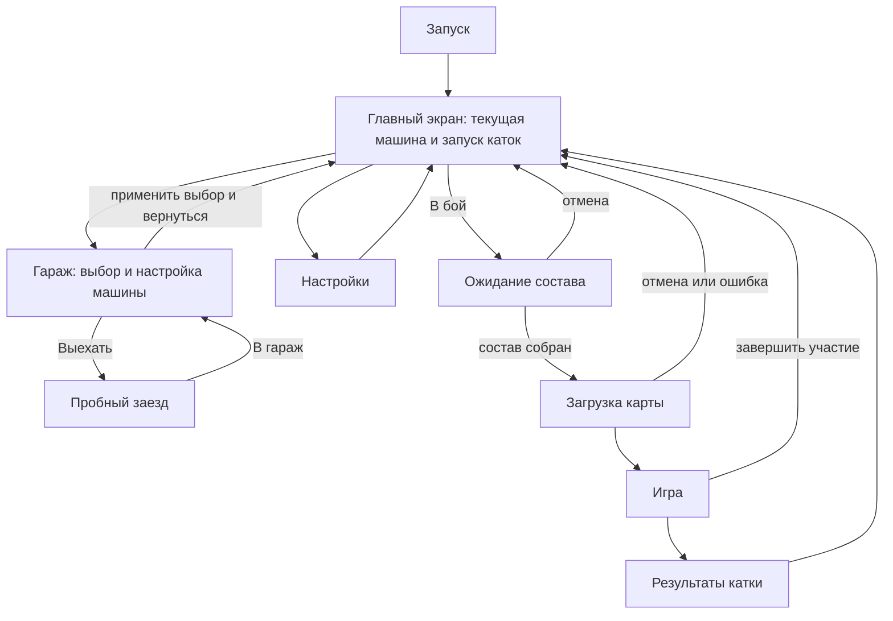

# Экраны и пользовательские сценарии Mad Machines

С 12 ноября 2026 года сетевой вход начинается на главном, а локальный пробный заезд — в гараже. Правила очереди и боя описаны в [плане первого Deathmatch](DEATHMATCH_PLAN.md). Фактическая реализация и проверки описаны в [текущем состоянии](CURRENT_STATE.md).

Связанные документы: [видение](VISION.md), [личная конфигурация и сервер](decisions/2026-11-10-game-flow.md), [принятая навигация](decisions/2026-11-10-main-screen.md).

## 1. Основная модель

**На главном игрок начинает сетевую игру. В гараже он выбирает, настраивает и испытывает текущую машину.**

В центре главного экрана вращается именно текущая машина с её применённой конфигурацией. Это та машина, на которой игрок собирается играть. После выбора другой машины или изменения настроек в гараже главный экран показывает новый выбор.

Сетевой сервер по-прежнему определяет карту, режим, фазу и допустимость машины. Эти сведения и ожидание старта отображаются в области запуска на главном экране. Наличие серверной сессии не требует отдельного экрана для её выбора или отдельной комнаты ожидания.

Экраны не обязаны соответствовать Unity-сценам: главный, гараж и настройки могут быть представлениями одной сцены. Долгая операция получает временное наложение загрузки. Пауза, ошибки и подтверждения также являются наложениями.

## 2. Карта экранов

С результатов игрок возвращается на главный, где можно снова запустить тот же режим, изменить условия или зайти в гараж. Сетевой повтор начинается с главного. После пробного заезда игрок возвращается к настройкам и выбранной локации в гараже.

## 3. Текущая машина

| Данные | Смысл |
| --- | --- |
| Текущая машина | Один выбранный автомобиль игрока, общий для главного экрана, гаража и следующего запуска |
| Применённая конфигурация | Настройки, с которыми главный показывает машину и формируется запрос на игру |
| Изменения в гараже | Предпросмотр до применения; ещё не заменяет сохранённое состояние |
| Допущенная сервером конфигурация | Подтверждённые сервером машина и настройки для конкретного участия |
| Машина текущей катки | Зафиксированная при запуске/появлении конфигурация; последующая настройка не меняет её посреди игры |

Предлагаемое поведение гаража: «Применить» сохраняет настройки и назначает выбранный автомобиль текущим. «На главный» возвращает к главному экрану. Если изменения не применены, предлагается «Применить и вернуться», «Не применять», «Остаться».

Выбор машины и её настройки сохраняются между запусками приложения. Настройки каждой машины сохраняются отдельно: переключение между автомобилями не должно стирать их индивидуальные конфигурации. В первой реализации доступна только T100, без фиктивных карточек других машин.

Личная конфигурация не заменяется молча, если сервер её запрещает. На главном показываем ограничение и действие «В гараж». На сервер отправляются допустимые параметры, а не произвольные силы или значения физики.

## 4. Состав экранов

### S01. Главный экран

**Задача:** показать текущую машину и дать начать любую поддерживаемую катку.

Предлагаемая композиция:

- В центре/справа — крупная вращающаяся текущая машина; доступны остановка вращения и ручной обзор.
- Рядом с машиной — название и краткая конфигурация: привод и другие реально работающие параметры.
- Слева — «Гараж», «Настройки», «Выход».
- В области запуска — тип игры, режим, условия и основная кнопка. Выбор открывается на этом же экране, без перехода в отдельный раздел подготовки.
- Имя игрока доступно в верхней части экрана; отдельный аккаунт для локальной игры не требуется.

| Элемент | Действие |
| --- | --- |
| Режим | Выбрать свободную езду, гонку, стрелковый полигон или боевую трассу там, где они реализованы |
| Карта | При сетевом входе показать подтверждённую сервером карту |
| Правила | Краткие цель, условия и штрафы выбранного режима; подробности раскрываются здесь же |
| В бой вдвоём | Подать заявку в очередь на двух игроков |
| Бой с ботом | Начать Deathmatch на свободном сервере одним клиентом |
| Адрес сервера | Открыть настройки подключения |
| Гараж | S02. Выбор, настройка и пробный заезд |
| Настройки | S06 |
| Выход | Подтверждение закрытия приложения |

Гараж запоминает выбранную локацию для повторного пробного заезда.

#### Сетевая игра на главном

Клиент подключается к сохранённому адресу в фоне. Зелёный индикатор означает установленную связь, красный — её отсутствие. Для «В бой вдвоём» требуются две заявки. Для «Бой с ботом» достаточно одной. В обоих вариантах сервер выдаёт T100 со штатной пушкой и выбранным приводом.

| Состояние области запуска | Содержимое и действия |
| --- | --- |
| Сервер недоступен | Красный индикатор, автоматические повторы подключения |
| Сервер подключён | Зелёный индикатор, «В бой вдвоём» и «Бой с ботом» |
| Ждём других участников | Счётчик состава и «Отменить ожидание» |
| Состав собран | Сервер загружает карту и ждёт подключения обоих клиентов |

Переход в гараж снимает заявку. После настройки игрок возвращается на главный и может подать новую заявку.

### S02. Гараж

**Задача:** выбрать текущую машину и выполнить действия с ней.

Крупная модель, список доступных автомобилей, название, достоверные характеристики, настройки и детали. Настройки первой машины: полный, передний, задний привод. Следующее развитие — мощность, типы колёс, другие машины и сменные узлы по мере реализации их правил.

| Кнопка | Действие |
| --- | --- |
| Выбор автомобиля | Предпросмотр автомобиля и его сохранённых настроек |
| Применить | Назначить выбранный автомобиль текущим, сохранить настройки |
| Сбросить настройки | Вернуть стандартную конфигурацию выбранного автомобиля в предпросмотре |
| Выехать | Запустить свободную езду на выбранной локации. Для черновика доступно «Применить и выехать» |
| На главный | S01; при неприменённых изменениях обработать их явно |

Для пробного заезда доступны асфальтовая трасса, грунтовая трасса и стрельбище. Заезд проходит в одиночной свободной езде и возвращает в гараж. Возвращение на главный показывает применённую конфигурацию для сетевой игры.

Изменение параметра обновляет предпросмотр и те характеристики, влияние на которые известно. Выдуманные рейтинги скорости или управляемости не используются. Пустые вкладки ещё не реализованных деталей не показываются.

### S03. Подключение / загрузка — временное наложение

**Задача:** объяснить заметную задержку, не создавать лишний шаг при быстром запуске.

Предложение для первого варианта: отдельное наложение появляется, если операция длится дольше примерно 0,5 секунды. Значение можно подобрать по ощущению интерфейса; искусственной минимальной длительности нет. Мгновенный запуск сразу переводит в игру.

Статусы соответствуют действию: «Подключаемся», «Проверяем машину», «Загружаем карту», «Получаем состояние игры». Показываются подтверждённые карта и режим. Процент выводится только у измеряемой загрузки.

«Отмена» останавливает участие/подключение и возвращает на главный с прежним выбором. Если техническую загрузку нельзя оборвать немедленно, её окончание не должно создавать машину и входить в катку после отмены. Повторные нажатия не создают несколько запросов.

Ожидание начала матча показывается на главном, а не выдаётся за незавершённую загрузку. При ошибке — причина, «Повторить» или «На главный»; повтор запроса соединения не является самостоятельным запуском новой катки.

### S04. Игра

**Задача:** управлять машиной и понимать цель текущей катки.

| Режим | Основные данные HUD |
| --- | --- |
| Свободная езда | Скорость, оружие, перезарядка |
| Гонка | Время, следующие ворота, прогресс, штрафы; в сети — положение среди участников |
| Стрелковый полигон | Оставшееся время, очки и цели |
| Боевая трасса | Время, ворота, цели и накопленные штрафы |
| Deathmatch | Время до конца, скорость, оружие, прочность, уничтожения, смерти и статус участников |

Вверху показываются данные режима. Скорость, состояние машины, орудие, боеприпас и готовность выстрела находятся в нижних панелях. Миникарта справа внизу ориентирована севером вверх и показывает свою машину.

В прицельном виде камера смотрит из-за орудия, а над скоростью показано направление корпуса относительно взгляда. В Deathmatch наведите центральную точку на цель. Поправка на падение снаряда рассчитывается автоматически в обеих камерах. В прицельном виде видно расстояние до выбранной точки. Если траектории или угла орудия не хватает, об этом сообщает подпись под перекрестием. Стрельбище сохраняет отдельную разметку и ручную установку дальности. Миникарту, дальность в бою и разметку стрельбища можно скрыть в настройках.

Esc открывает локальную паузу или сетевое меню с подписью «Игра продолжается». Доступны «Продолжить», «Настройки», «Управление», «На главный» и «Выйти из игры». Управление и стрельба при открытом меню прекращаются; закрытие меню не производит выстрел тем же кликом.

«На главный» завершает текущую попытку/участие. При незавершённом испытании показываем подтверждение потери текущего результата. В свободной езде предупреждение о потере соревновательного результата не нужно. В Deathmatch добровольный выход даёт техническую победу оставшемуся игроку.

Новый пробный заезд начинается в гараже, новый сетевой — на главном. Восстановление R остаётся действием внутри текущей катки по её правилам и не считается запуском новой попытки.

В сетевой гонке личный финиш показывает время и «Ждём завершения заезда». Общий результат появляется после серверного завершения. Наблюдение за оставшимися участниками возможно как состояние игрового экрана, если реализовано; оно не требует комнаты сессии. Сетевые фазы и прогресс определяет сервер.

### S06. Настройки

**Задача:** настроить приложение и управление.

Изображение, звук, управление и имя игрока — по мере наличия работающих параметров. Техническое назначение сетевого подключения при необходимости вынесено в дополнительные параметры, а сетевой запуск остаётся на главном.

«Применить» сохраняет, «Отмена» возвращает применённые значения, «По умолчанию» меняет черновик. Смена разрешения требует «Оставить» с автоматическим откатом через 15 секунд без подтверждения. Несохранённые изменения при уходе обрабатываются явно.

Из главного возврат ведёт на главный. Вызов из игрового меню возвращает в него: локальная пауза сохраняется, сетевой мир продолжает работать. Настройки машины в этот экран не входят.

### S07. Результаты катки

**Задача:** объяснить итог только что завершённой игры.

Локально: карта, режим, использованная машина, время/очки, штрафы, личный лучший результат. В сети: общий итог сервера, личная позиция/счёт и статус по правилам режима. Текущая машина и машина завершённой катки могут различаться в будущем; результат всегда относится к зафиксированной конфигурации катки.

| Кнопка | Действие |
| --- | --- |
| На главный | S01 с прежними условиями; запуск повтора находится там |

Результаты не запускают следующую попытку, не подтверждают готовность к следующему раунду и не ведут прямо в гараж. Для новой катки игрок возвращается на главный и пользуется его областью запуска. В сетевом режиме подключение между раундами можно сохранять до возвращения на главный; подтверждение нового участия находится там. Конкретные правила сохранения места ещё предстоит согласовать.

У непрерывной свободной езды нет обязательной таблицы победителей: при выходе игрок возвращается сразу на главный.

## 5. Ошибки, отмена и возвраты

| Ситуация | Поведение |
| --- | --- |
| Сервер не ответил | Ошибка в области запуска главного, возможность повторить проверку/изменить адрес |
| Последнее место заняли после запроса | Отказ с актуальной причиной, возврат на главный; место и машина не остаются |
| Несовместимая сборка или карта | Понятное объяснение и «Подробности» для диагностики; возврат на главный |
| Машина запрещена правилами | Причина и «В гараж»; параметры не заменяются автоматически |
| Сервер начал раунд во время входа | Повторный допуск по актуальной фазе; ожидание отображается на главном |
| Отмена подключения/загрузки | Главный, прежний выбор, отсутствие фонового входа и занятого места |
| Потеря связи в игре | Управление прекращается, сообщение поверх игрового экрана; восстановление или возврат на главный |
| Переподключение успешно | Сервер определяет роль; прежний прогресс возвращается только при поддержке восстановления участника |
| Сервер закрыл игру | Сообщение и возврат на главный |
| Уход из гаража с изменениями | Применить и вернуться / не применять / остаться |

Автоматическое восстановление связи ограничивается по времени и допускает отмену. Оно продолжает уже инициированное участие, а не начинает новый режим без действия игрока. Повторная попытка не обещает вернуть прежнюю машину/место, если сервер этого не поддерживает.

Esc сначала закрывает верхний диалог. На главном открывает подтверждение выхода; в гараже ведёт на главный с обработкой изменений; в настройках возвращает к экрану вызова. Подтверждения используют названия действий («Завершить заезд», «Остаться»), а не безликие «Да»/«Нет».

Кнопки и фокус доступны с клавиатуры. Причины недоступности и состояния не кодируются только цветом. Названия сцен, GUID и версии протокола не занимают игровой интерфейс.

## 6. Сценарии пользователя

| ID | Последовательность | Ожидаемый результат |
| --- | --- | --- |
| U01 | Запуск приложения → главный | Видна текущая сохранённая машина; для старта не нужно заходить в гараж |
| U02 | Главный → гараж → асфальтовая трасса → «Выехать» | Свободная езда без сервера |
| U03 | Главный → гараж → выбрать другую машину → применить → главный | Вращается новая текущая машина; следующая катка использует её |
| U04 | Гараж → изменить привод → применить → главный | Главный и запуск используют применённую конфигурацию |
| U05 | Гараж → изменить настройки → уйти без применения | Явный выбор применить/не применять/остаться; нет молчаливой потери |
| U06 | Главный → гонка → финиш → результаты → главный → «Играть» | Новая попытка с прежними условиями и текущей машиной |
| U07 | Результаты → главный → изменить карту/режим → «Играть» | Выбранная новая катка, конфигурация машины сохранена |
| U08 | Главный → зелёный индикатор → «В бой» | Появляется ожидание состава. Сервер назначает карту после двух заявок |
| U09 | Два игрока на своих главных экранах запускают игру | Независимые текущие машины, настройки и ввод |
| U10 | Вход до старта сетевой гонки → ожидание/готовность на главном | Сервер подтверждает состав и общий старт без комнаты ожидания |
| U11 | Вход во время гонки при наличии места | Правило позднего входа видно на главном; нет собственного старта поверх общей гонки |
| U12 | Ожидание старта → открыть гараж | Заявка снимается |
| U13 | Открыть меню во время сетевой игры | Мир продолжается, свои команды не поступают; закрытие возвращает управление |
| U14 | Раньше других финишировать в сетевой гонке | Личный итог, ожидание завершения общего заезда; нет перезапуска для остальных |
| U15 | Сетевые результаты → главный → подтвердить следующий заезд | Новое участие инициируется только главным экраном |
| U16 | Отменить подключение → запустить пробный заезд из гаража | Нет фонового переподключения или лишнего сетевого участника |
| U17 | Потерять связь → восстановить либо вернуться на главный | Актуальная роль по серверу или освобождение участия |
| U19 | Выйти из игры → открыть снова | Машина и настройки сохранены. Связь восстанавливается, заявка подаётся по кнопке |
| U20 | Завершить пробный заезд через паузу | Гараж с прежней машиной и выбранной локацией |

Эти сценарии задают будущую ручную проверку пользователем и не являются отчётом о выполненных проверках. Подготовленный код второго прохода покрывает главный, гараж, свободную езду на трёх одиночных локациях, настройки мыши и сетевую свободную езду. Сценарии готовности/позднего входа в гонку остаются для будущих серверных режимов.

## 7. Порядок реализации и открытые вопросы

1. Запускать пробные заезды из гаража, а сетевую игру с главного. Использовать одно сохранённое состояние текущей машины.
2. После пробного заезда возвращать в гараж, после сетевой игры или её результатов — на главный.
3. Сделать сетевой вход и его статусы частью главного. Отдельное наложение показывать только для заметного подключения/загрузки. Сохранить доступность нынешней свободной езды.
4. Добавить серверные раунды и состояния ожидания/готовности на главном после определения правил режима; комнату сессии не создавать.
5. Развивать настройки по мере появления работающих параметров.

Для обсуждения остаются: конкретные подписи и расположение выбора режимов на главном; способ назначения сервера в дальнейшем; применение изменений гаража; удержание подключения/места между катками и при входе в гараж; правила старта, позднего входа и восстановления сетевых режимов. Первый режим с раундами и числовые параметры отсчётов пока не утверждены.

Основная структура уже определена пользователем. Дополнительные предложения этого документа не должны выдаваться за утверждённые правила или реализованные возможности.
